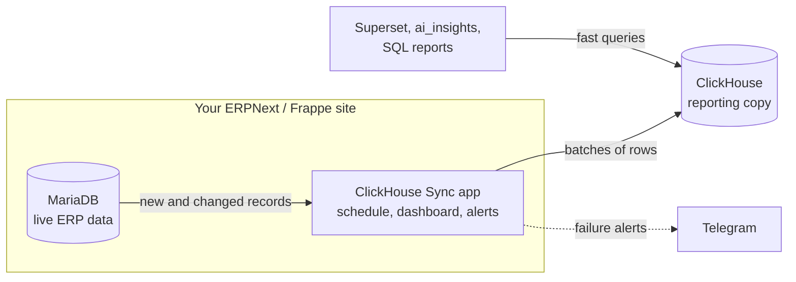
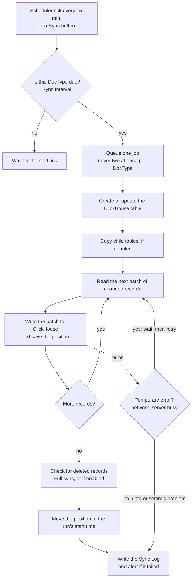
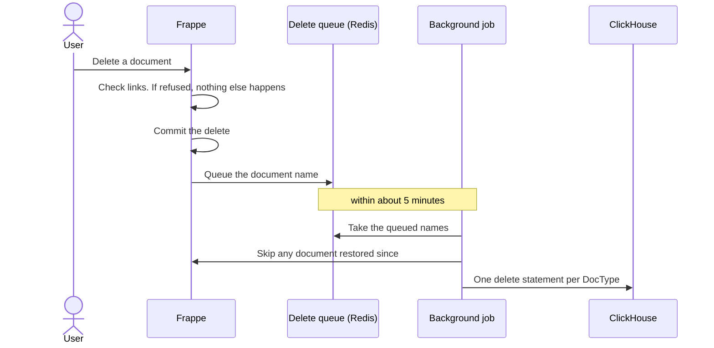

# ClickHouse Sync

A Frappe app that keeps a copy of your ERPNext / Frappe data in
[ClickHouse](https://clickhouse.com/), a database built for fast reports and
analytics.

**Why.** Heavy reports, dashboards (Superset) and AI tools (the `ai_insights`
app) slow down the MariaDB database that ERPNext itself runs on. This app
copies the DocTypes you choose into ClickHouse and keeps them up to date, so
those tools query the copy and the ERP stays fast.

**How, in one paragraph.** For each DocType you add a *ClickHouse Sync
Configuration*. The app creates a matching ClickHouse table and, on a schedule
you set, copies new and changed records into it, along with child tables
(such as invoice items) if you want them. Deleted documents are removed or
flagged. A dashboard shows what is synced, what is running and what failed,
and Telegram can alert you to failures.

**Version:** 1.7.0 (plus the unreleased changes below) · **Frappe:** v15 ·
**ClickHouse:** any version with the HTTP interface (tested against 26.6) ·
**License:** MIT

---

## At a glance



Your users keep working in ERPNext as usual. Reports read the ClickHouse
copy, which is a few minutes behind the live data.

## Contents

**Using the app**

- [Getting started](#getting-started): install, connect, sync your first DocType
- [Key terms](#key-terms): the words used in the app, in plain language
- [What it does](#what-it-does)
- [How a sync works](#how-a-sync-works) (with diagrams)
- [Choosing settings](#choosing-settings): which options to pick for each DocType
- [Monitoring dashboard](#monitoring-dashboard)
- [Telegram alerts](#telegram-alerts)
- [Querying the warehouse](#querying-the-warehouse)
- [Day-to-day operation](#day-to-day-operation)
- [Troubleshooting](#troubleshooting)

**Running and maintaining it**

- [Install and update](#install-and-update)
- [Settings reference](#settings-reference)
- [Security](#security)
- [Known limitations](#known-limitations)

**For developers**

- [For developers](#for-developers): tests, code layout, API
- [Changelog](#changelog)

---

## Getting started

You need a ClickHouse server and a System Manager login on your Frappe site.

1. **Install the app** on your bench. See [Install and update](#install-and-update).
2. **Connect to ClickHouse.** In Desk, open **ClickHouse Settings**. Enter the
   host, port, database, username and password, tick **Secure** if ClickHouse
   is on another server, save, and press **Test Connection**. It should report
   OK.
3. **Choose a DocType to copy.** Create a new **ClickHouse Sync
   Configuration**. Pick the **Source DocType** (for example *Sales Invoice*),
   keep **Sync Mode** on *Incremental*, choose a **Delete Strategy** (see
   [Choosing settings](#choosing-settings)), tick **Sync Child Tables** if you
   need line items, and save.
4. **Run the first sync.** Open the dashboard at
   `/app/clickhouse-sync-dashboard` and press **Incremental** on the DocType's
   row. The first run copies every record, so a large DocType can take a while;
   after that, each run copies only what changed.
5. **Check it worked.** On the dashboard the run shows *Completed*, and the
   DocType's *Difference* column is 0 or close to it.
6. **Query the copy.** The table is named `tab_` + the DocType in lower case,
   for example `tab_sales_invoice`. See [Querying the warehouse](#querying-the-warehouse).

From then on the scheduler keeps it up to date by itself. Optionally, set up
[Telegram alerts](#telegram-alerts) so you hear about failures.

## Key terms

| Term | What it means |
| --- | --- |
| **Warehouse** | The ClickHouse database that holds the copy. |
| **Configuration** | One *ClickHouse Sync Configuration* document per DocType you copy. It holds that DocType's settings. |
| **Incremental sync** | Copies only records created or changed since the last sync. The normal mode. |
| **Full sync** | Reads every record again. Slower; use it to repair or for DocTypes changed outside Frappe. |
| **Sync position (cursor)** | The point in time up to which records have been copied. Shown as *Last Sync Timestamp*. |
| **Overlap (Cursor Safety Lag)** | Each incremental run re-reads a few minutes before the sync position, so records saved at the last moment are never missed. |
| **Batch** | A group of records read and written together (25,000 by default). Progress is saved after each batch. |
| **Soft Delete / Hard Delete** | When a document is deleted in Frappe, Soft Delete keeps its row in the warehouse with a deleted flag; Hard Delete removes the row. |
| **`FINAL`** | A word added to ClickHouse queries so each record appears once, in its latest version. |
| **Sync Log** | One record per run: when it ran, how many records, and the error if it failed. |
| **Scheduler tick** | Frappe's scheduler checks every 15 minutes which DocTypes are due for a sync. |

## What it does

- **Any DocType, no code.** Create a *ClickHouse Sync Configuration* per
  DocType. The ClickHouse table is created and kept in step with the DocType's
  fields automatically.
- **Incremental sync** reads only records changed since the last successful
  sync position. **Full sync** re-reads the whole table. Either can be run on
  demand from the dashboard, whatever the configuration's saved mode.
- **Your schedule per DocType.** Each configuration has its own *Sync
  Interval*: every 15 minutes for busy DocTypes, hourly or daily for large
  ones that change rarely.
- **Resumable and loss-free.** Incremental runs read records in
  `(modified, name)` order and save their position after every batch, so a
  failed, cancelled or timed-out run resumes from the last successful batch
  without skipping anything.
- **Duplicate-safe.** Tables use `ReplacingMergeTree` keyed on `name`;
  re-sending a record replaces the earlier version.
- **Deletes.** Choose per DocType: *Ignore*, *Soft Delete* (flag the row) or
  *Hard Delete* (remove it). A delete is queued once it has committed in
  Frappe and applied in batches by a background job; full syncs (optionally
  incremental syncs too) reconcile anything the queue missed.
- **Child tables** can be synced alongside their parent (one ClickHouse table
  per child DocType).
- **Exact values.** Money is copied as exact decimals, and date-times in new
  tables carry Frappe's time zone. A value that cannot be stored in its
  column (for example text in a number field) is reported on the run, not
  silently dropped.
- **Resilient.** Transient failures (connection drops, ClickHouse memory
  limits, too many parts, timeouts) are retried with backoff; permanent ones
  (bad data, schema problems, wrong password) fail fast with a clear
  category. Every run, including failed ones, writes a *ClickHouse Sync Log*.
- **Cancellable.** Stop a running or queued sync from the dashboard; it stops
  after the current batch and keeps its progress.
- **Observable.** A live dashboard, four reports and Telegram alerts.
- **Safe by default.** Password and secret fields are never copied, and only
  System Managers can change where data is sent.

## How a sync works

Every sync follows the same steps. A run either finishes completely or stops
at the last batch that worked; the next run continues from there.



**Deletes** take a separate, shorter path. Nothing is sent to ClickHouse while
the user is deleting, so a delete Frappe refuses never reaches the warehouse,
and a ClickHouse outage never slows down the ERP:



Anything the queue misses (for example after a Redis restart) is caught when
deleted records are checked during a sync.

### The sync position

`last_sync_timestamp` on the configuration is the sync position, also called
the cursor. Each incremental run reads records with
`cursor − overlap ≤ modified ≤ run start`, ordered by `modified, name`. The
overlap is the configuration's *Cursor Safety Lag* (5 minutes by default).

- The **overlap** catches records whose transaction committed slightly
  after they were stamped. Re-reading them is harmless, because ClickHouse
  keeps one version per record. The dashboard shows these as *Re-checked*.
- Capping each run at its **start time** means an edit made while a run is in
  progress is picked up by the next run, never skipped.
- The cursor only moves forward, and a failed run leaves it at the last batch
  that succeeded.

Records with an empty or future `modified` cannot be reached by incremental
sync. They are counted and reported in the run message; a full sync picks
them up.

**Full mode** reads the table in primary-key order and only moves the cursor
after the whole run succeeds.

## Choosing settings

Start with the defaults; change a setting only when one of these applies.

| Your situation | What to set |
| --- | --- |
| Most DocTypes (invoices, orders, entries) | **Sync Mode** Incremental, **Sync Interval** 15 |
| A large DocType that changes rarely (items, customers, price lists) | Incremental, **Sync Interval** 60 to 1440 (daily) |
| Records are changed by direct SQL or imports that don't update `modified` | **Sync Mode** Full with a long **Sync Interval**, or an occasional manual Full sync |
| You want deleted documents kept for history | **Delete Strategy** Soft Delete, and filter `_ch_is_deleted = 0` in reports |
| The warehouse must match the ERP exactly | **Delete Strategy** Hard Delete |
| Deletions don't matter for your reports | **Delete Strategy** Ignore |
| You need line items, taxes or other grid rows | **Sync Child Tables** on |
| A very large DocType (millions of records) | Before its first sync: **Partition By Creation Month** on; keep **Optimize Only On Full** on |
| Long imports or slow submits run on the DocType | **Cursor Safety Lag** 900 to 3600 seconds |
| The DocType has personal or sensitive fields | List them in **Excluded Fields** (passwords and secrets are always excluded) |

Every field is described in the [Settings reference](#settings-reference).

## Monitoring dashboard

Open **`/app/clickhouse-sync-dashboard`**. It requires the System Manager or
ClickHouse Sync Manager role.

| Section | What it shows |
| --- | --- |
| Health | One verdict (Healthy / Attention / Action needed) with the reason, and whether ClickHouse is reachable |
| Overall statistics | DocTypes configured, source records (MariaDB), warehouse records (ClickHouse), pending records, failed records and runs, synchronized %, last successful sync |
| Live synchronization | One card per queued or running sync: phase, progress, records processed / written / inserted / updated / re-checked / skipped / failed, batch, cursor, speed, elapsed, time remaining, retry attempt, Stop |
| DocTypes | Per DocType: status, source and warehouse counts, difference, pending, synced %, last success and failure, with Incremental / Full / Stop / Logs buttons; sortable and filterable |
| Errors | Recent failed runs with category, batch, retries and failed records; a full report per run (message, traceback, records in the failed batch); DocTypes failing now, with a retry button |
| Analytics | Records written per day, runs per day by outcome, warehouse table sizes, recent runs, for 7 / 30 / 90 days |

Page buttons: **Incremental Sync (All)**, **Start → Full Sync (All) / Retry
Failed**, **Stop All**, **Refresh**; the menu has **Recount Records** and links
to configurations, logs, reports and settings.

**Where the numbers come from.** Nothing is estimated in the browser.

- **Live progress** is written by the sync worker to Redis after every batch
  (`clickhouse_sync.clickhouse.live_status`).
- **Source records** are `COUNT(*)` in MariaDB, limited to 10 seconds per
  table. Very large tables fall back to the database's row estimate, marked ≈.
- **Warehouse records** are `SELECT count() … FINAL` in ClickHouse, excluding
  soft-deleted rows.
- **Pending** counts records with `modified` after the DocType's cursor. It is
  at most a minute old; the other counts are cached for 10 minutes (menu →
  Recount Records forces a recount).
- **Synchronized %** is (source − pending) ÷ source.
- **Failed records** are the records in batches ClickHouse rejected, summed
  over failed runs in the selected window.
- **Inserted / Updated / Re-checked** are only known for incremental runs that
  already have a previous sync position; otherwise the card shows a dash.

The live monitor refreshes every 3 seconds while a sync is queued or running;
the whole page every 30 seconds. Polling pauses while the page or browser tab
is hidden. A running sync that reports no progress for 10 minutes is flagged
*Stalled* (3 hours while it optimizes a table or checks for deletes, which are
single long statements), and as a lost worker if its job has left the queue.

## Telegram alerts

Configure in **ClickHouse Settings → Alert Mode**:

- **Consolidated** (default): one digest per scheduler tick, sent only when a
  run failed, plus a once-daily heartbeat so you know the pipeline is alive.
- **Per Run**: a message after every run, filtered by **Alert On**
  (Failures / All / Never).
- **Never**: no alerts.

Credentials live in ClickHouse Settings, or fall back to *Zoom Telegram
Settings* if the `zoom_meeting` app is installed, so one bot can serve both.
**Send Test Digest** / **Send Test Telegram Alert** on the settings form
verify the wiring.

An hourly check also notifies System Managers when a configuration has not
completed a sync within **Staleness Alert Hours** (0 disables it).

## Querying the warehouse

Always query with `FINAL` to get the latest version of each record. Without it
you may briefly see an older and a newer version of a record that was just
re-synced.

```sql
SELECT customer, sum(grand_total)
FROM erp_warehouse.tab_sales_invoice FINAL
WHERE docstatus = 1
GROUP BY customer;
```

With *Soft Delete*, also add `WHERE _ch_is_deleted = 0`. A soft delete is
written as a new version of the row with the flag set, so `FINAL` is what
makes the flag visible. `_ch_synced_at` records when each row was written.

Tables created by this version declare Frappe's system time zone on their
DateTime columns, so instants are correct whatever the server's OS time zone.
Tables created earlier have no time zone: their values were written using the
worker's OS time zone and are left as they are, so old and new rows agree.

## Day-to-day operation

| Task | How |
| --- | --- |
| Sync one DocType now | Dashboard → row → **Incremental** or **Full**, or **Sync Now** on the configuration form |
| Sync everything | Dashboard → **Incremental Sync (All)** or **Start → Full Sync (All)** |
| Stop a sync | Dashboard → **Stop** on its card or row, or **Stop All** |
| Retry what failed | Dashboard → **Start → Retry Failed**, or **Retry** in an error report |
| Re-copy a DocType from scratch | Configuration form → **Reset Cursor**, then Sync Now (or run a Full sync from the dashboard) |
| Check source and warehouse agree | Dashboard → DocTypes → *Difference* column; menu → **Recount Records** for fresh counts |
| Investigate a failure | Dashboard → Errors → **Details**, or the Failed Syncs report |
| Sync a large DocType less often | Configuration form → **Sync Interval (Minutes)**, for example 1440 for daily |
| Apply queued deletes now | `bench --site <site> execute clickhouse_sync.tasks.flush_pending_deletes` |

**After upgrading from 1.7.0:** run **Reset Cursor** and then **Sync Now** on
each incremental configuration once. Earlier versions could skip records
after an interrupted run (see the changelog); this re-copies them. Run large
DocTypes outside working hours.

## Troubleshooting

| Symptom | Likely cause and fix |
| --- | --- |
| Dashboard looks unstyled or shows stray `<div …>` text | The browser is running a cached old script. Avatar menu → **Reload**, or open the page in a private window. Check the code is deployed: `grep -c chsync-dash-style clickhouse_sync/clickhouse_warehouse/page/clickhouse_sync_dashboard/clickhouse_sync_dashboard.js` prints 1 or more. |
| "ClickHouse unreachable" | Check host, port and Secure in ClickHouse Settings, and that the server's HTTP interface is reachable from the bench host. |
| Syncs stay *Queued* | No background worker is running the `long` queue. In development keep `bench start` running; in production check `sudo supervisorctl status`. |
| Stop does nothing | The Redis cache isn't reachable (check `redis-cli -p <port> ping` using the `redis_cache` port in `sites/common_site_config.json`). |
| Warehouse count higher than source | Deletes not propagated: the Delete Strategy is *Ignore*, documents were renamed, or no worker runs the `short` queue (check `sudo supervisorctl status`). Run a Full sync with Soft or Hard Delete to catch up. |
| A DocType syncs less often than every 15 minutes | Its **Sync Interval (Minutes)** is longer, or **Scheduler Enabled** is off. Manual runs from the dashboard are not affected. |
| Old Sync Logs disappeared | The daily cleanup removed logs older than **Log Retention Days**. Set it to 0 to keep every log. |
| A Sync Manager can't edit ClickHouse Settings | By design: only System Managers can. Changing host, port, user or TLS also asks for the password again. |
| "You need read permission on … to sync it" | The person saving the configuration can't read that DocType in Frappe. A user who can should save it. |
| Run message says "value(s) could not be converted" | Source values that don't fit the column type, such as text in an Int field, were written as empty. Fix the source data or the field type. |
| Warehouse count lower than source | Records not yet copied (see *Pending*), or lost by a version before this release: Reset Cursor and Sync Now. |
| Run fails with category *Data* | A value ClickHouse can't store in its column type. **Details** shows the message and the records in the failed batch. |
| `git push` says password authentication is not supported | Use a GitHub personal access token as the password, or SSH. |

## Install and update

```bash
cd ~/frappe-bench
bench get-app clickhouse_sync https://github.com/sharif-basha/clickhouse_sync.git
bench --site <site> install-app clickhouse_sync
bench restart        # or restart `bench start` in development
```

Python dependencies (`clickhouse-connect`, `requests`) install with the app.
You need a ClickHouse server reachable over its HTTP interface (default port
8123, or 8443 with TLS) and a ClickHouse user that can create tables in the
target database. Background workers must run the `long` queue (syncs) and the
`short` queue (deletes).

**Updating an existing install.** Try it on a staging site first. Pause the
scheduler and wait for running syncs to finish (dashboard → **Stop All**):

```bash
cd ~/frappe-bench
bench --site <site> disable-scheduler
bench --site <site> backup --with-files
```

Update the code, reinstall the package (needed since `setup.py` was removed:
the app now installs from `pyproject.toml`), migrate and rebuild:

```bash
cd ~/frappe-bench/apps/clickhouse_sync
git pull origin main
cd ~/frappe-bench
./env/bin/pip install -e apps/clickhouse_sync
bench --site <site> migrate
bench build --app clickhouse_sync
bench --site <site> clear-cache
bench restart
```

Before turning the scheduler back on, check **ClickHouse Settings → Log
Retention Days**: the daily cleanup deletes Sync Logs older than that (90 by
default; 0 keeps them all). Then:

```bash
bench --site <site> enable-scheduler
```

Finally reload Desk from the avatar menu → **Reload**, so the browser drops
its cached copy of the dashboard script. To go back, check out the previous
commit and repeat the same steps; run
`bench --site <site> execute clickhouse_sync.tasks.flush_pending_deletes`
first so no queued delete is left behind.

## Settings reference

### 1. ClickHouse Settings

| Field | Notes |
| --- | --- |
| Host, Port, Database, Username, Password | Connection. The password is stored encrypted. |
| Secure | Use HTTPS. Turn this on for any server not on the same machine or private network. |
| Compression | Compress inserts (recommended). |
| Connection Timeout, Send/Receive Timeout | Seconds. |
| Max Threads, Max Insert Block Size | Passed to ClickHouse as query settings. |
| Staleness Alert Hours | See Telegram alerts. |
| Log Retention Days | Sync Logs older than this are deleted daily (default 90; 0 keeps all). |
| Alert Mode, Alert On, Telegram Bot Token, Telegram Chat ID | See Telegram alerts. |

### 2. ClickHouse Sync Configuration (one per DocType)

| Field | Notes |
| --- | --- |
| Source DocType | The DocType to copy. The table is named `tab_` + the DocType in lower case with spaces as `_` (for example `tab_sales_invoice`). |
| Enabled / Scheduler Enabled / Priority | Disabled configurations are listed on the dashboard but not synced or totalled. Lower priority numbers are queued first. |
| Sync Interval (Minutes) | How often the scheduler runs it (default 15). The scheduler ticks every 15 minutes; use 60, 360 or 1440 for large Full-mode DocTypes. |
| Sync Mode | **Incremental** (recommended) or **Full**. |
| Cursor Safety Lag (Seconds) | Incremental runs re-read this much before the saved position (default 300), for transactions that commit late. Raise it where long imports or submits run. |
| Batch Size | Records per batch, kept between 1,000 and 100,000 (default 25,000). Use 5,000–10,000 for DocTypes with large text fields. |
| Auto Create Table / Auto Update Schema | Create the table and add new columns automatically. |
| Optimize After Sync / Optimize Only On Full | Run `OPTIMIZE TABLE … FINAL` after a run. This rewrites the whole table, so *Optimize Only On Full* is on by default for new configurations; query with `FINAL` between full syncs. |
| Delete Strategy | Ignore, Soft Delete (`_ch_is_deleted = 1`) or Hard Delete. |
| Reconcile Deletes (Incremental) | Also compare full key sets on incremental runs. Costly on large tables. Without it, incremental runs still check the child rows of every parent changed in the run. |
| Sync Child Tables | Copy the DocType's child tables too. |
| Partition By Creation Month | For large DocTypes: partition the table (and its child tables) by creation month, so post-sync OPTIMIZE rewrites only the months a run touched. Applies when the table is created. |
| Excluded Fields | Fields never copied (use the *Select Fields to Exclude* picker). Password fields and names such as `api_key`, `*_secret` and `*_token` are always excluded. |
| Retry Count / Retry Interval | Attempts per run and the base wait in seconds, doubled per attempt. |
| Last Sync Timestamp | The cursor; see [How a sync works](#how-a-sync-works). |

### 3. ClickHouse Sync Log

One record per run, with status, trigger, timings, record counts, message and
traceback. Reports: **Sync Summary**, **Failed Syncs**, **Slowest Syncs**,
**Largest Tables**.

### Roles

**ClickHouse Sync Manager** (shipped as a fixture) and **System Manager** can
use the dashboard, start and stop syncs and read logs. Only **System Manager**
can edit ClickHouse Settings. Saving a configuration requires read permission
on its Source DocType.

## Security

- Every API method checks for the System Manager or ClickHouse Sync Manager
  role. The dashboard's start and stop endpoints accept POST only.
- ClickHouse Settings are System Manager only, and changing the host, port,
  user or TLS setting requires re-entering the password, so the stored
  password cannot be redirected to another server.
- A configuration can only be saved by someone who can read its Source
  DocType; Single, virtual and child DocTypes are rejected.
- ClickHouse and Telegram credentials are Password fields (encrypted at rest).
  Telegram errors are logged with the bot token removed.
- Sensitive fields are excluded by name pattern and by the Excluded Fields
  list. The sync itself does not apply Frappe user permissions, so anyone who
  can query the ClickHouse database can read every synced DocType. Give BI
  tools a read-only ClickHouse user limited to the warehouse database.
- Use **Secure** (TLS) when ClickHouse is on another host.

## Known limitations

- **Schedule granularity** is the 15-minute scheduler tick: a *Sync
  Interval* is rounded up to the next tick.
- **Renamed documents** leave their old name behind until a Full sync with a
  delete strategy reconciles it.
- **Queued deletes** live in the Redis cache; a Redis restart loses the ones
  not yet applied. Reconciliation repairs them.
- **Per-run OPTIMIZE** on incremental runs (*Optimize Only On Full* off)
  rewrites the whole table unless it is partitioned by creation month.
- **Partitioning and time zones** are fixed when a table is created. To apply
  *Partition By Creation Month* or a time zone to an existing table, drop it
  in ClickHouse and run a Full sync.
- **Delete reconciliation** pages through ClickHouse names and looks each page
  up in MariaDB. A single anti-join would be faster, but MariaDB's
  case-insensitive collation and ClickHouse's byte order sort names
  differently, so range-based comparisons could flag live rows as deleted.
- **Column changes** that cannot be migrated safely (for example a field
  changed from Data to Int, or narrowing a type) are logged and the existing
  column is kept; values are converted for the column that exists.
- **Existing Currency columns** created by 1.7.0 keep 6 decimal places (new
  tables use Frappe's 9). Widening them would allow fewer integer digits, so
  it is not done automatically.
- **Live dashboard state** lives in the Redis cache; a Redis restart clears
  it until the next run. Sync Logs are unaffected. A running sync's log is
  only written when it ends.
- **Failed records** are tracked per batch, not per record. There is no
  dead-letter list of individual records yet.
- Very large initial loads in Incremental mode read in `modified` order,
  which is slower than a Full-mode pass, but they can resume.

## For developers

Background for people changing the app's code.

### Testing

```bash
# On a bench (includes tests that need Frappe):
bench --site <site> set-config allow_tests true      # test/staging sites only
bench --site <site> run-tests --app clickhouse_sync

# Without a bench, from the app folder (Python 3.10+):
python -m unittest discover -s clickhouse_sync/tests -t .
```

The engine and dashboard tests run the real sync code against in-memory
stand-ins (`tests/_fakes.py`): the source database is SQLite executing the
engine's actual SQL, and ClickHouse and Redis are simulated. They cover
cursor resume after failure at every batch, edits during a run, late commits,
200 randomised histories of edits / failures / cancels, retries and error
classification, child tables, cancellation, and every dashboard endpoint
including role checks. No ClickHouse server is needed. Don't run tests on a
production site.

### Code layout

```
clickhouse_sync/
├── clickhouse/
│   ├── sync_engine.py     # run_sync: read, insert, cursor, retries, deletes, logging
│   ├── live_status.py     # live run state in Redis for the dashboard
│   ├── connection.py      # cached clickhouse-connect client, health check
│   ├── schema.py          # table DDL, schema reconciliation, field exclusion
│   ├── type_mapping.py    # Frappe field type -> ClickHouse type, value coercion
│   ├── exceptions.py      # error types, transient/permanent classification, categories
│   ├── warehouse_stats.py # table sizes from system.parts (shared by API, dashboard, report)
│   └── alerts.py          # Telegram messages
├── api/
│   ├── api.py             # stable endpoints for the desk script, forms, cards, other apps
│   └── dashboard.py       # dashboard endpoints
├── tasks.py               # scheduler and background-job entry points
├── hooks.py               # scheduler events, after_delete hook, assets, fixtures
├── clickhouse_warehouse/  # module: DocTypes, dashboard page, reports, workspace
└── tests/
```

### API

All methods are whitelisted under `clickhouse_sync.api` and need one of the
two roles.

| Method | HTTP | Purpose |
| --- | --- | --- |
| `dashboard.overview(days=7)` | GET | Everything the dashboard shows |
| `dashboard.live()` | GET | Queued and running syncs only |
| `dashboard.error_detail(log)` | GET | Full report for one failed run |
| `dashboard.start_sync(configuration, mode=None)` | POST | Queue one sync; `mode` = `Full` or `Incremental` for a one-off run |
| `dashboard.start_all(mode=None)` | POST | Queue every enabled configuration |
| `dashboard.retry_failed()` | POST | Queue configurations whose latest run failed |
| `dashboard.stop_sync(configuration)` / `dashboard.stop_all()` | POST | Stop after the current batch |
| `dashboard.recount(configuration=None)` | POST | Recompute record counts now |
| `api.sync_now(configuration)`, `api.sync_all()`, `api.cancel_sync(configuration)`, `api.test_connection()`, `api.schema_status(configuration)`, `api.table_status()`, `api.analytics(days)` | any | Used by the configuration form and the earlier dashboard |

From Python, `clickhouse_sync.clickhouse.sync_engine.run_sync(config_name,
trigger="Manual", mode=None)` runs a sync in the current process and returns
the result. `clickhouse_sync.clickhouse.connection.get_client()` returns a
ClickHouse client and is reused by `ai_insights`.

## Changelog

### Unreleased

Three rounds of fixes from a full code review (pull request #4). Upgrading:
follow [Install and update](#install-and-update); `bench migrate` adds four
fields (Log Retention Days, Sync Interval, Cursor Safety Lag, Partition By
Creation Month). Nothing changes for existing ClickHouse tables until you opt
in.

#### Review fixes, round 3

- Queued deletes for several DocTypes are no longer lost when one of them hits
  a temporary ClickHouse error.
- On an unmigrated `UInt8` column, integer values are kept instead of being
  collapsed to 0/1.
- A failure alert whose Telegram delivery failed is sent again by the next
  digest.

#### Review fixes, round 2

- **Per-configuration schedule:** *Sync Interval (Minutes)* lets large
  Full-mode DocTypes run hourly or daily instead of every 15 minutes.
- **Configurable overlap:** *Cursor Safety Lag (Seconds)* per configuration.
- **Time zones:** new tables declare Frappe's system time zone and receive
  aware datetimes; the driver had converted naive values with the worker's OS
  time zone. Existing tables are unchanged.
- **Soft deletes** are written as a new row version (`INSERT ... SELECT
  FINAL`) instead of an `ALTER TABLE ... UPDATE` mutation.
- **Partition By Creation Month** (opt-in, new tables): post-sync OPTIMIZE
  rewrites only the months a run touched.
- **Unconvertible values** (e.g. text in an Int field) are counted and
  reported on the run instead of silently becoming NULL.
- Delete reconciliation compares 5,000 names per round trip (was 1,000).
- Dashboard: pending counts are cached for 60 s; the error category
  breakdown covers up to 500 failed runs instead of the 25 listed; optimizing
  and reconciling phases are not shown as stalled for up to 3 hours.
- One shared batch reader for parent and child tables, one Redis read helper,
  and one `system.parts` query for the API, dashboard and Largest Tables report.
- One version number (`clickhouse_sync.__version__`) and one build system
  (`pyproject.toml`); `setup.py` removed.

#### Review fixes, round 1

**Data correctness**

- Deletes are queued only after the delete commits (`after_delete`) and
  applied in batches by a background job. A delete Frappe refused ("linked
  with ...") used to remove the row from ClickHouse anyway, and a ClickHouse
  outage made every delete in the ERP hang.
- Currency values are written as exact decimals (they went through `float`)
  with Frappe's 9 decimal places; high precisions no longer overflow.
- Widening a column keeps it `Nullable`; unsafe changes (`UInt64` → `Int64`,
  `Int64` → `Float32`) are refused.
- Inserts use the live column types: a type change that cannot be migrated,
  or a missing column with Auto Update off, no longer fails every run.
- New columns are nullable even for mandatory fields; NULLs in older
  non-nullable columns get the column's empty value instead of failing.
- Worker processes pick up a changed ClickHouse password immediately.

**Performance**

- Incremental runs check deleted child rows only for parents changed in the
  run, instead of scanning the whole child table every 15 minutes.
- Rows already soft-deleted are no longer flagged again on every run.
- *Optimize Only On Full* defaults to on.
- Sync Logs are purged after *Log Retention Days* (default 90); the log
  table has indexes on configuration and status.
- The redundant hourly and daily re-queueing was removed.

**Reliability and monitoring**

- Wrong credentials are reported as *Configuration* and not retried; MariaDB
  errors are retried by error number (deadlock, lock wait, lost connection).
- Retry backoff is capped at 5 minutes with jitter; a failed run rolls back
  before its log is written.
- "Running Syncs" counts come from live state (they were always 0).
- Starting a sync that is already queued says so instead of reporting a run
  that will not happen; re-queueing keeps the original queue time.
- Child-table syncs report progress and can be cancelled.
- Batch digests no longer report a failure twice or count cancelled runs.

**Security**

- ClickHouse Settings are System Manager only; endpoint changes require the
  password again. Configurations require read access to the Source DocType.
- The Telegram bot token is removed from logged and returned errors.

Existing configurations keep their *Optimize Only On Full* value: turn it on
for large incremental DocTypes.

### Stage 1 fixes

**Data correctness**

- Incremental sync no longer loses records. Previously a failed, cancelled or
  timed-out run could move the cursor past records it had not read, and
  edits made during a successful run could be skipped. Records are now read
  in `(modified, name)` order up to the run's start time, with a 5-minute
  overlap.
- Child-table failures now fail the run, and child tables sync before the
  parent's cursor moves. Previously failures were ignored and the run
  reported success.
- A ClickHouse outage now produces a Failed log and an alert. Previously the
  job crashed without writing either.
- Errors are classified by type and ClickHouse error code. Job time limits
  are no longer retried, and server memory-limit and too-many-parts errors
  are.
- The Cancel button now reaches a running sync. Previously Frappe's per-job
  cache hid the request. Stopping a queued sync now works too.
- Alert messages include the run duration again.

**Monitoring**

- New monitoring dashboard with live progress from the sync worker, record
  counts from both databases, error categories and per-run reports, and
  start / stop / retry controls.
- One-off Full or Incremental runs from the dashboard, without changing the
  configuration.
- A Redis outage can no longer fail a sync.

**Tests**

- 101 unit tests that run with or without a bench (106 on a bench).

No DocType changes and no migration needed. After deploying, run Reset Cursor
and Sync Now once per incremental configuration (see
[Day-to-day operation](#day-to-day-operation)).

### 1.7.0 and earlier

See the git history.
